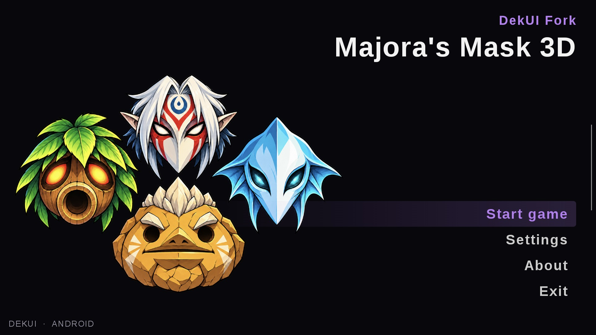

# DekUI Fork

**An emulator fork tailored for a single-screen Majora’s Mask 3D experience.**

Supports Android, Windows, Linux, and macOS. See Releases for available packages and supported architectures.

DekUI Fork builds on [tgacquin’s DekUI](https://github.com/tgacquin/mm3d-dekui), the [Azahar emulator](https://github.com/azahar-emu/azahar), and [Project Restoration](https://restoration.zora.re/). It runs MM3D through an adapted 3DS emulator; it is not a game recompilation or a native rewrite of the game.

[Downloads](https://github.com/OTPR26/DekUI-Fork/releases) · [Android setup](docs/android/SETUP.md) · [Build instructions](docs/android/BUILD.md)

## Features

- Single-screen gear, masks, items, maps, file select, and Bomber’s Notebook inherited from DekUI.
- A full-screen menu for touch, mouse, and controllers; Android also supports a swipe from the left edge during gameplay.
- Controller bindings and button-layout preferences, touch overlay controls, and screen swapping.
- Customizable Wii U Style HUD with adjustable positions, scale, spacing, and visibility; custom texture-folder selection through Android’s file picker.
- Separate Field of View and Camera Distance controls; adjustable walk, climb, and swim speeds.
- Optional controller-neutral English item prompts.
- Adult Link appearance mod generated on the device from your own OoT3D ROM, with adult voice clips imported from that ROM.
- Dark Link appearance mod with red eyes, a matching sword, and adult voices.
- Twilight Princess Link generated from your own GameCube Twilight Princess ROM, including action voices, matching high-resolution textures from subfolders, and an optional TP Master Sword and sheath.
- Original green, blue, and red tunic variants, an optional Master Sword model and matching HUD icon, and matching textures from your own OoT3D texture pack when available.

## Get started

1. Install the package for your platform from [Releases](https://github.com/OTPR26/DekUI-Fork/releases).
2. Select your own **Majora’s Mask 3D USA Rev 1 / v1.1** ROM during setup.
3. Open Settings to choose a custom-texture folder, controller bindings, and HUD options.
4. For Adult Link or Dark Link, open **Settings → Mods**, select your own supported OoT3D ROM and optional texture folder, then generate the mod before starting gameplay.
5. For Twilight Princess Link, choose that player model in **Settings → Mods**, select your own GameCube Twilight Princess ROM (ISO, GCM, or RVZ) and optional texture folder, then generate the mod. Texture matching searches subfolders.

No game ROM, imported player model, imported voices, save file, or personal texture pack is supplied with the release. Generated assets stay on your device. Changing Adult Link, tunic, sword, or voice selection requires restarting gameplay. See [setup](docs/android/SETUP.md) for details.

## Preview limitations

These appearance mods need broader gameplay testing. Some masks, facial expressions, and attachments still need broader testing with Adult Link. Texture replacement depends on a matching texture being present in the selected pack. The experimental Cheats page can remain disabled when its live save-layout check does not match; it is not advertised as a reliable save editor.

Android uses `io.github.otpr26.dekuifork`. When moving from the prototype, grant file access to reuse Internal storage/mm3dport, then reselect external texture folders. Existing saves, generated mods, HUD settings, and shared controller bindings are retained. Close the prototype before using the new app.

## Credits and license

- **tgacquin / DekUI:** single-screen MM3D design, game presentation, and the original fork.
- **Azahar and Citra contributors:** emulator foundations.
- **leoetlino / Project Restoration contributors:** Restoration patches and features.
- Additional libraries and contributors retain their original notices throughout the source tree.

This project retains its upstream GPL licensing; see [license.txt](license.txt) and the notices in individual files and dependencies. DekUI Fork is an unofficial fan project and is not affiliated with Nintendo. The new Deku flower branding and mask startup artwork are included with this fork; inherited emulator credits remain in place.

For the upstream DekUI feature and development notes, see [the preserved upstream README](docs/UPSTREAM-DEKUI.md).
